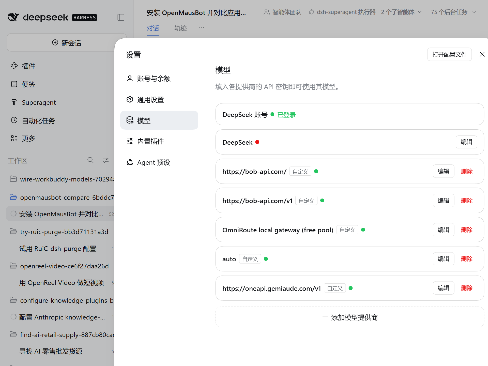
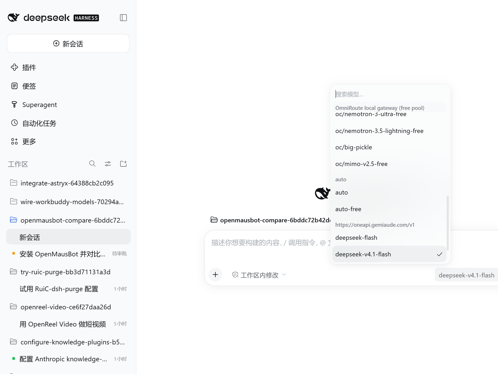
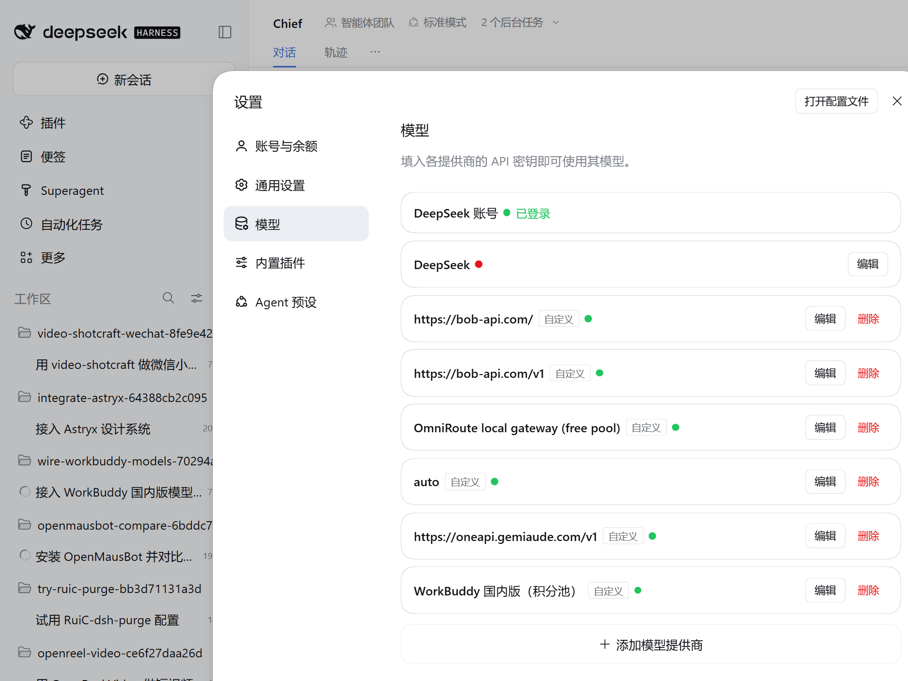
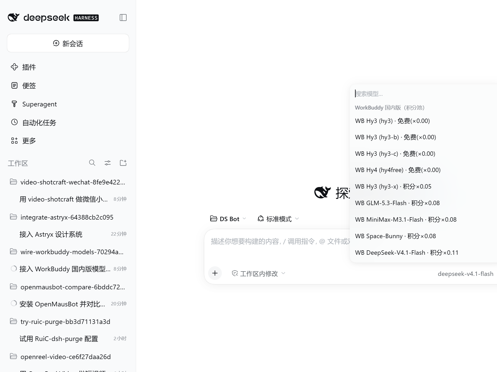

# WorkBuddy 国内版模型接入（积分池）

> 把 WorkBuddy 国内版（codebuddy.cn）的模型——**含付费模型**——接入运行中的 DeepSeek Harness，
> 全部经 WorkBuddy 积分池网关路由；模型名直接标注「积分×倍率」或「免费」，用之前就能看出会不会消耗积分。

## 接入结果

| 项 | 值 |
|---|---|
| Provider id | `workbuddy` |
| 显示名 | `WorkBuddy 国内版（积分池）` |
| 协议 | OpenAI 兼容（`openai-completions`） |
| baseURL | `http://127.0.0.1:7866/v1`（WSL 本地兼容性代理 → Windows `7863`，见「兼容性代理」） |
| 兼容性代理 | `/home/dsh/bin/wb-pool-proxy.py` 监听 `127.0.0.1:7866`，cron 每 2 分钟保活 |
| 凭据引用 | `WORKBUDDY_POOL_KEY`（值在 `~/.dsh/.credentials.yaml` 的 `refs`，本仓库不含钥匙值） |
| 模型数 | 31（4 个免费 + 25 个付费 + 2 个浮动/未知费率） |
| 配置方式 | DSH **设置 → 模型** 的 settings 路径写入当前 profile 的 Cordis patch；运行中的 host 热加载，**无需重启** |
| 默认模型 | **交付不改动、不重置用户当前选择的默认模型**；见下方「注意」：在 GUI 选模型会同时保存为全局默认，最终由操作者决定。联调期间（11:47 前）为 `oneapi / deepseek-v4.1-flash`；采集时刻 composer 当前模型见「视觉证据」。 |

在 DSH Web GUI（`http://127.0.0.1:3082`）的 **设置 → 模型** 里可以看到「WorkBuddy 国内版（积分池）」；
新会话输入框下方的 **选择模型** 下拉里，WorkBuddy 模型以 `WB … · 积分×…` / `WB … · 免费(×0.00)` 出现。

## ⚠️ 注意：在 GUI 里选模型会顺带改全局默认模型

DSH 的 `session/selectModel` 有一个副作用：**在输入框下方的「选择模型」里点选某个模型，会同时把它保存为全局默认模型**
（不只是当前会话）。因此：

- 本次接入**不改动、也不重置**用户当前的默认模型选择；默认模型最终由操作者决定；
- 联调期间（至 11:47）默认模型是 `oneapi / deepseek-v4.1-flash`；此后操作者在 GUI 里试用新增的 WB 模型，
  默认模型随之被切换成 `workbuddy / cn:*`（每次点选都会保存），这属于产品既有行为，不是本次接入的配置改动；
- 如果这不是你要的默认模型：打开 **设置 → 模型** 改回，或让 agent 用 `session/selectModel` 写回；
- 11:04 还发生过一次默认模型被改成 `workbuddy / cn:hy3` 的事件（同样是一次 GUI 模型点击的副作用），已恢复。

## 路由：DSH → 兼容性代理 → 积分池网关 → WorkBuddy 账号池

```
DSH（profile: superagent）
  └─ llm-pi-ai provider `workbuddy`，api=openai-completions
       └─ http://127.0.0.1:7866/v1        ← wb-pool-proxy.py（WSL 本地改写代理，只改 system 里一个词）
            └─ http://<Windows 主机 IP>:7863/v1   ← workbuddy2api（Go 网关，OpenAI 兼容）
                 └─ WorkBuddy 国内版账号池（3 个 cn 账号，按模型倍率扣积分）
```

- **7866 是 DSH 实际连接的地址**：provider 的 baseURL 固定为 `http://127.0.0.1:7866/v1`，由 WSL 内的
  `wb-pool-proxy.py` 做一次请求体改写后再转发到 Windows 主机 IP 的 7863（为什么必须这样，见「兼容性代理」一节）。
  主机 IP 由代理每 60 秒重新解析，**Windows/WSL 重启换 IP 不需要改 DSH 配置**。
- **7863 是积分池的模型出口**：`workbuddy2api` 监听 `0.0.0.0:7863`，按上游账号池挑健康账号转发请求，
  并按每个模型的倍率扣积分（响应里的 `usage.credit` 即本次扣费）。
- **7864 管理台（`/accounts`）是同一个积分池的仪表盘**：`http://localhost:7864/accounts` 显示的
  账号与余额，就是 DSH 消耗的同一批国内版账号积分。它只监听 Windows 回环，**WSL 访问不到**，
  只能在 Windows 浏览器里看。
- 7865（`ai-pool-gateway` 聚合器）同样只监听回环，且只是转发层；直连 7863 已覆盖全部国内版模型，
  本方案不经过它。

即：**每调用一次付费 `WB … · 积分×…` 模型，7864 `/accounts` 里的积分就相应减少**；
`WB … · 免费(×0.00)` 的模型不扣积分。请求的模型 id 需带 `cn:` 前缀（DSH 模型 id 即目录里的真实 id）。

## 兼容性代理（127.0.0.1:7866）

> DSH 的 provider baseURL 指向本机代理 `127.0.0.1:7866`（`/home/dsh/bin/wb-pool-proxy.py`），
> 代理再把请求原样转发到 Windows 上的 `7863`。**它不是多此一举**：没有它，多数模型的真实 agent 回合会被
> 上游判为「非授权渠道」而失败（见下）。

### 为什么需要：真实 agent 请求 503 的根因

DSH 的 system prompt 里固定带一句 111 字符的 `@` 文件引用说明（来自 DSH 自身的 `FILE_REFERENCE_PROMPT`）：

```
Tokens prefixed with @ are paths the user explicitly referenced. Relative paths resolve from the workspace root
```

Windows 上的 `workbuddy2api` 出站前会按「上游内容审核黑名单指纹」脱敏（`upstream/internal/upstream/sanitize.go`），
但这份清单没有覆盖这句。于是：

1. 这句原样发到上游 → `/v2/chat/completions` 返回 **400 `{"code":11128,"msg":"Illegal API invocation from an unapproved channel"}`**（渠道校验）；
2. 网关按设计回退到 `/console/chat/completions`；但 `/console` 是另一套渠道，**不提供 cn 侧多数模型** →
   返回 **`{"code":11102,"msg":"model [X] service info not found"}`**；
3. 网关把回退路径上的 11102 当作「这条路径没有该模型」，继续轮换账号；3 个 cn 账号都如此 →
   对客户端汇总成 **503 `no_healthy_account`**。

所以客户端看到的 11102 是误导：真实原因是**指纹触发的渠道校验 + `/console` 回退不支持该模型**，而
`/status` 里账号全程 healthy、没有冷却。短请求（如会话标题生成）能成功，只是因为它 system 很短、没带这句。

### 代理做什么：只改一个词

`wb-pool-proxy.py` 只对 `POST /v1/chat/completions` 请求体里 **system / developer** 消息的文本做一次子串替换：

```
Tokens prefixed with @  →  Tokens prefixed by @
```

- 只动这一个词（`with` → `by`），语义完全不变，DSH 的 `@` 引用语法说明仍然成立；
- 请求的其它部分（模型、tools、user 消息、参数）一律不动；
- 响应原样透传：SSE 流式、`usage.credit`、`finish_reason`、工具调用块都正常；
- **不存任何密钥**：`Authorization` 头原样转发，代理自身不读凭据文件、不写密钥日志；
- 验证方式：同一份完整 DSH payload 经代理 **5/5 HTTP 200**，直连 7863 对照组仍 503 —— 证明「改写」才是修复点。

**compat 开关修不了这个问题**：`supportsDeveloperRole` / `supportsStore` / 流式与 `max_tokens` 字段 /
`reasoning_effort` 等组合全部试过，与 503 无关——问题在网关的指纹清单与回退路径，不在 DSH 的请求形状。

### 部署与保活

| 项 | 值 |
|---|---|
| 脚本 | `/home/dsh/bin/wb-pool-proxy.py`（Python 标准库，无第三方依赖） |
| 监听 | `127.0.0.1:7866` → `http://<WSL 默认网关 IP>:7863`（主机 IP 每 60 秒重新解析，失败时强制重解析并重试一次） |
| 保活 | `/home/dsh/bin/wb-pool-proxy-keepalive.sh`，用户 crontab `*/2 * * * *`（跑在本 WSL 的 cron） |
| 日志 | `/home/dsh/.dsh/state/wb-pool-proxy.log`（只有启动行，不含请求/密钥） |
| 自测 | `python3 /home/dsh/bin/wb-pool-proxy.py --selftest`（会发 5 次全量请求，约 3 积分，仅升级排障用） |

脚本已随本仓库提交，可复现部署：`tools/workbuddy-pool-proxy/wb-pool-proxy.py` 与 `tools/workbuddy-pool-proxy/keepalive.sh`
（部署时复制到 `/home/dsh/bin/` 并 `chmod 700`，`crontab` 加一行 `*/2 * * * * /home/dsh/bin/wb-pool-proxy-keepalive.sh`；脚本本身不含任何密钥，只转发 `Authorization` 头）。

```bash
# 状态：期望 200
pgrep -af '/home/dsh/bin/wb-pool-proxy.py' || echo "proxy down"
curl -s -o /dev/null -w '%{http_code}\n' -H "Authorization: Bearer $WORKBUDDY_POOL_KEY" \
  http://127.0.0.1:7866/v1/models

# 启动 / 重启（cron 每 2 分钟也会自动拉起）
pkill -f '/home/dsh/bin/wb-pool-proxy.py'; sleep 1
nohup setsid python3 /home/dsh/bin/wb-pool-proxy.py >> /home/dsh/.dsh/state/wb-pool-proxy.log 2>&1 &

# 停止（先摘掉 cron 保活，否则 2 分钟内会被重新拉起）
crontab -l | grep -v 'wb-pool-proxy-keepalive.sh' | crontab -
pkill -f '/home/dsh/bin/wb-pool-proxy.py'

# 日志
tail -20 /home/dsh/.dsh/state/wb-pool-proxy.log
```

**故障现象**：模型报 `connection refused` / `proxy_error` → 代理没在跑：先跑一次
`/home/dsh/bin/wb-pool-proxy-keepalive.sh`（它就是 cron 用的同一个保活脚本，会按需拉起并写日志），
再 `pgrep -af wb-pool-proxy` 确认；仍未起来就执行上面的启动命令；
报 `502 proxy_error` 且 Windows 刚重启过 → 代理会自动重解析主机 IP 并重试一次，仍失败则确认 Windows 侧
`wb2api.exe`（7863）在运行。

### 它不做什么

- 不存密钥、不读 `~/.dsh/.credentials.yaml`、日志里没有请求内容；
- 不改 system prompt 的其它内容，不改 user / tools / 参数，不改响应；
- 不额外扣费：`usage.credit` 由上游正常返回；
- 不替代 Windows 上的 7863 网关，只是它前面的一个小转发层。

### 长期建议：在 Windows 侧根治（推荐）

代理只是**客户端绕行**。最干净的长期修复在 Windows 侧（需 operator 打补丁，超出本次「不改 Windows」的范围）：

1. 在 `upstream/internal/upstream/sanitize.go` 的指纹清单里加入这句 `@` 文件引用说明（`with` 版本的 111 字符句式），
   或对 `Tokens prefixed with @` 统一做脱敏/改写；
2. 修正错误上报：`/console` 回退路径上的 `11102 model service info not found` 不应汇总成 `503 no_healthy_account`，
   应保留 11128 渠道校验信息，并提示「内容指纹被渠道风控」；
3. 修好后把 provider `baseURL` 改回 `http://<Windows 主机 IP>:7863/v1`，停掉代理并摘掉 cron 即可。

### 不用代理时能用的模型

不接代理、直连 7863 时，**只有同时在 `/console` 渠道有货的模型**能扛住真实 agent 回合；其余模型会
503（`/console` 没有它们）。当前已配置的 31 个模型里可用的是：

| 模型 | 单次完整 agent 请求实测 credit | 备注 |
|---|---|---|
| `cn:hy3` | 0（免费） | 首选：免费、192K 上下文、支持 tools/reasoning |
| `cn:hunyuan-chat` | ~0.09 | 最便宜的付费选项 |
| `cn:minimax-m2.7` | ~0.67 | prompt cache 命中率高 |
| `cn:kimi-k2.5` | ~2.8 | 首 token 偶尔很慢 |
| `cn:deepseek-v3-2-volc` | ~6 | |
| `cn:glm-5.2` | ~7.5 | 本组最贵 |

> 这是网关 `/console` 回退路径的覆盖问题，不是模型本身不可用。接上代理后指纹不再触发，这 25 个模型的
> 503 前提随之消失（已用 `cn:glm-5.3` 的全量 agent 请求经代理实测 5/5 返回 200；其余模型按同一致命串根因推断，
> 未逐一出全量请求——每次约 7 万 prompt tokens，成本较高）。
> 未配置的 17 个仍不在网关模型目录里，与代理无关。

## 模型清单

> 倍率/上下文来自网关 `GET /v1/models`（WorkBuddy 下发的 `credits`、`context_length` 等字段）；
> 「实测」为 2026-11-07 对每个模型发一次最小请求的真实结果：48 个国内版对话模型中 31 个可服务、
> 17 个不在网关当前模型目录（未接入）。上游模型清单动态变化，可重新拉取后补配。
> 接入后经兼容性代理，指纹拦截不再触发（`cn:glm-5.3` 全量请求已实测 5/5 通过）；直连 7863 时只有 6 个可用，见「不用代理时能用的模型」。

### 免费模型（4 个，不扣积分）

| 模型 id | DSH 显示名 | 积分倍率 | 计费 | 上下文 | 最大输出 | 图片 | 推理 | 工具 |
|---|---|---|---|---|---|---|---|---|
| `cn:hy3` | WB Hy3 (hy3) · 免费(×0.00) | x0.00 | 免费 | 192K | 64K | ✓ | ✓ | ✓ |
| `cn:hy3-b` | WB Hy3 (hy3-b) · 免费(×0.00) | x0.00 | 免费 | 192K | 64K | ✓ | ✓ | ✓ |
| `cn:hy3-c` | WB Hy3 (hy3-c) · 免费(×0.00) | x0.00 | 免费 | 192K | 64K | ✓ | ✓ | ✓ |
| `cn:hy4free` | WB Hy4 (hy4free) · 免费(×0.00) | x0.00 | 免费 | 960K | 64K | ✓ | ✓ | ✓ |

### 付费模型（25 个，按倍率扣积分池）

| 模型 id | DSH 显示名 | 积分倍率 | 计费 | 上下文 | 最大输出 | 图片 | 推理 | 工具 |
|---|---|---|---|---|---|---|---|---|
| `cn:hy3-x` | WB Hy3 (hy3-x) · 积分×0.05 | x0.05 | 付费 | 192K | 64K | ✓ | ✓ | ✓ |
| `cn:glm-5.3-flash` | WB GLM-5.3-Flash · 积分×0.08 | x0.08 | 付费 | 1000K | 131K | ✓ | ✓ | ✓ |
| `cn:minimax-m3.1-flash` | WB MiniMax-M3.1-Flash · 积分×0.08 | x0.08 | 付费 | 1000K | 128K | ✓ | ✓ | ✓ |
| `cn:space-bunny` | WB Space-Bunny · 积分×0.08 | x0.08 | 付费 | 1000K | 128K | ✓ | ✓ | ✓ |
| `cn:deepseek-v4.1-flash` | WB DeepSeek-V4.1-Flash · 积分×0.11 | x0.11 | 付费 | 1000K | 128K | ✓ | ✓ | ✓ |
| `cn:mimo-v2.6-pro` | WB Xiaomi MiMo-V2.6-Pro · 积分×0.13 | x0.13 | 付费 | 1000K | 128K | ✓ | ✓ | ✓ |
| `cn:fast-model` | WB 快速 · 积分×0.15 | x0.15 | 付费 | 300K | 48K | ✓ | ✓ | ✓ |
| `cn:deepseek-v4-flash` | WB Deepseek-V4-Flash · 积分×0.17 | x0.17 | 付费 | 1000K | 50K | ✓ | ✓ | ✓ |
| `cn:minimax-m2.7` | WB MiniMax-M2.7 · 积分×0.26 | x0.26 | 付费 | 200K | 48K | ✓ | ✓ | ✓ |
| `cn:deepseek-v3-2-volc` | WB DeepSeek-V3.2 · 积分×0.29 | x0.29 | 付费 | 96K | 32K | ✓ | ✓ | ✓ |
| `cn:hy4-preview-ctrl` | WB Hy4 preview (hy4-preview-ctrl) · 积分×0.29 | x0.29 | 付费 | 960K | 64K | ✓ | ✓ | ✓ |
| `cn:hy4-preview-exp` | WB Hy4 preview (hy4-preview-exp) · 积分×0.29 | x0.29 | 付费 | 960K | 64K | ✓ | ✓ | ✓ |
| `cn:hy4preview-exp1` | WB Hy4 preview (hy4preview-exp1) · 积分×0.29 | x0.29 | 付费 | 960K | 64K | ✓ | ✓ | ✓ |
| `cn:hy4preview-exp2` | WB Hy4 preview (hy4preview-exp2) · 积分×0.29 | x0.29 | 付费 | 960K | 64K | ✓ | ✓ | ✓ |
| `cn:hy4std` | WB Hy4 (hy4std) · 积分×0.29 | x0.29 | 付费 | 960K | 64K | ✓ | ✓ | ✓ |
| `cn:step-5-preview` | WB Step-5-Preview · 积分×0.33 | x0.33 | 付费 | 1000K | 64K | ✓ | ✓ | ✓ |
| `cn:kimi-k2.5` | WB Kimi-K2.5 · 积分×0.45 | x0.45 | 付费 | 256K | 32K | ✓ | ✓ | ✓ |
| `cn:balanced-model` | WB 均衡 · 积分×0.50 | x0.50 | 付费 | 300K | 48K | ✓ | ✓ | ✓ |
| `cn:deepseek-v4-pro` | WB DeepSeek-V4-Pro · 积分×0.51 | x0.51 | 付费 | 1000K | 128K | ✓ | ✓ | ✓ |
| `cn:glm-5.3` | WB GLM-5.3 · 积分×0.69 | x0.69 | 付费 | 1000K | 64K | ✓ | ✓ | ✓ |
| `cn:kimi-k2.8-preview` | WB Kimi-K2.8-Preview · 积分×0.77 | x0.77 | 付费 | 1000K | 64K | ✓ | ✓ | ✓ |
| `cn:glm-5.2` | WB GLM-5.2 · 积分×0.79 | x0.79 | 付费 | 1000K | 64K | ✓ | ✓ | ✓ |
| `cn:kimi-k3.1-pro` | WB Kimi-K3.1-Pro · 积分×0.97 | x0.97 | 付费 | 1000K | 32K | ✓ | ✓ | ✓ |
| `cn:deep-model` | WB 极致 · 积分×1.00 | x1.00 | 付费 | 300K | 48K | ✓ | ✓ | ✓ |
| `cn:kimi-k3-1` | WB Kimi-K3 · 积分×1.62 | x1.62 | 付费 | 1000K | 32K | ✓ | ✓ | ✓ |

### 浮动 / 未知费率（2 个）

| 模型 id | DSH 显示名 | 积分倍率 | 计费 | 上下文 | 最大输出 | 图片 | 推理 | 工具 |
|---|---|---|---|---|---|---|---|---|
| `cn:auto` | WB Auto · 积分浮动 | 浮动 | 浮动 | 256K | 32K | ✓ | ✓ | ✓ |
| `cn:hunyuan-chat` | WB Hunyuan-Turbos · 积分未知 | 未知 | 未知 | 128K | 8K | ✓ | — | ✓ |

COUNT used 31

### 未接入：17 个当前 503 的国内版模型

上游返回 `503 no_healthy_account`（message 内含上游 `11102 model [...] service info not found`），
即**这批账号当前拿不到该模型服务**（未开通/下架/灰度），不是 DSH 配置问题：

- `cn:glm-4.6v`
- `cn:minimax-m2.5`
- `cn:glm-4.6`
- `cn:hy4-preview-x`
- `cn:deepseek-v3-0324-lkeap`
- `cn:deepseek-v3-1`
- `cn:deepseek-v3-1-lkeap`
- `cn:deepseek-v3-1-volc`
- `cn:kimi-k2-thinking`
- `cn:glm-5.0-turbo`
- `cn:deepseek-r1-0528`
- `cn:deepseek-r1-0528-lkeap`
- `cn:deepseek-v3-0324`
- `cn:default-1.1`
- `cn:default-1.2`
- `cn:hunyuan-2.0-instruct`
- `cn:kimi-k2-instruct-taiji`

池子恢复后可这样复核并补配（拿到 200 就说明可用了）：

```bash
HOSTIP=$(ip route show default | awk '{print $3}')          # Windows 主机 IP
KEY_PATH=~/.dsh/.credentials.yaml                             # 仅示意：实际用已配置的凭据引用
# 列出上游当前下发的全部模型 id
curl -s -H "Authorization: Bearer $WORKBUDDY_POOL_KEY" "http://$HOSTIP:7863/v1/models" \
  | jq -r '.data[].id' | grep '^cn:' | sort

# 逐个探测某个未接入模型（200 = 恢复可用；503 = 仍不可用）
curl -s -o /dev/null -w '%{http_code}\n' \
  -H "Authorization: Bearer $WORKBUDDY_POOL_KEY" -H 'Content-Type: application/json' \
  -X POST "http://$HOSTIP:7863/v1/chat/completions" \
  -d '{"model":"cn:glm-4.6","messages":[{"role":"user","content":"hi"}],"max_tokens":8}'
```

### 未接入：3 个国内版媒体模型

`cn:hunyuan-image-alpha-edit`（图生图）、`cn:kling-video-v3`（文/图生视频）、
`cn:minimax-video-h3`（文/图生视频）——非对话模型，DSH 文本链路不用，未配置。

### 未接入：23 个 `global:*` 国际版模型

网关同时下发国际版（workbuddy.ai）模型，但对应账号当前余额为 0，本方案只接国内版 `cn:*`。

## 监控积分消耗

DSH 使用 7863 的全局钥匙，7864 管理台没有「按 key」的细分统计，因此积分监控用这几处：

| 目的 | 方式 |
|---|---|
| 单次调用扣了多少 | 响应里的 `usage.credit`（免费模型为 `0`）；`usage.quota` 还有模型配额百分比与重置时间 |
| 累计 / 按模型 | `GET /v1/stats` → `total.credit`、各模型 `credit` / `credit_per_req` / 倍率原值 |
| 账号余额 | `GET /status` → `accounts[].credits`（上游定时任务刷新的快照，有滞后） |
| 直观仪表盘 | Windows 浏览器打开 `http://localhost:7864/accounts`（同一账号池） |

```bash
BASE="http://127.0.0.1:7866/v1"        # 经兼容性代理（/v1 与 /status 都原样透传）
# 不走代理时：HOSTIP=$(ip route show default | awk '{print $3}'); BASE="http://$HOSTIP:7863/v1"

# 累计扣费（total.credit）与各模型明细
curl -s -H "Authorization: Bearer $WORKBUDDY_POOL_KEY" "$BASE/stats" | jq '.total.credit, .models'

# 账号余额
curl -s -H "Authorization: Bearer $WORKBUDDY_POOL_KEY" "$BASE/status" | jq '.accounts[] | {nickname, credits}'
```

**倍率 vs 实际扣费**：`credits`（如 `x0.11` / `x0.29`）是网关声明的**倍率**，实际扣费按 token 量折算，
还有缓存折扣（实测缓存命中率可达 60%–77%）。因此：

- 小请求的 `usage.credit` 可能因取整/缓存显示为 `0`，但 `/v1/stats` 的模型累计仍会增长；
- **不要用倍率 × token 精确预估费用**，展示时标明「付费 / 倍率」即可；
- 免费模型 `x0.00` 恒不扣；`cn:auto` 倍率随实际路由浮动；`cn:hunyuan-chat` 上游未下发倍率，按「未知」保守对待。

接入 + 根因排查 + 验证期间，池侧累计 credit 约 **352**（10:01 网关重启起算，截至 11:47，含 operator 自己的
WorkBuddy 流量）；本次工作占大头的是 145-tools 全量 payload 的重放测试（例如 `cn:glm-5.3` 一项累计 173 credit /
242 次请求）。按池内约 4100 积分算，本次接入共消耗约 **8%**；正常单次 agent 回合的成本见「验证」一节的成本提醒。

## 验证

- **GUI（截图证据，见下）**：运行中的 GUI 设置 → 模型出现「WorkBuddy 国内版（积分池）」，模型下拉出现 31 个
  `WB … · 积分×… / 免费(×0.00)` 模型；**未重启 dsh 进程**。AFTER 两张截图在最终修订
  `75ec0c835a1737384d39dea58328ef69f5280b1a119dced1aac8e9335760165f`（2026-11-07 12:00:38 -0500，12874 B，llm-pi-ai rev 3，baseURL 已切到兼容性代理）下重新采集，场景/视口/主题与 BEFORE 完全一致。
- **完整 agent 回合已跑通（经兼容性代理）**：在隔离会话 `session-dab35ed0…`（未调用 `session/selectModel`）里，
  `workbuddy / cn:glm-5.3` 完成一次干净的完整 agent 回合——turn 3：seq 63 `turn/start` 11:37:34 → seq 68
  `session/title-llm-request`（route `workbuddy/cn:glm-5.3`）→ seq 69 provider 产出的标题 → seq 70
  `assistant/message` 11:37:42（content「好的」，source `{kind:model, provider:workbuddy, model:cn:glm-5.3}`，
  usage `inputTokens 70943 / outputTokens 3 / total 71906 / cacheReadTokens 960`）→ seq 71 `step/end` →
  seq 72 `turn/end` `{kind:completed}`。一次成功、无重试。这是「DSH → 代理 → 7863 → 账号池」整条链路的端到端证据。
  扣费：DSH 不持久化网关的 `usage.credit`，池侧 `/v1/stats` 里 `cn:glm-5.3` 的 `last_seen` 正好落在 11:37:42.689，
  credit 由 144.09 → 173.01（混有 operator 流量），按 ×0.69 倍率与 kimi-k2.5（×0.45、全量 payload ≈7 credit）
  校准，**该回合约 10 credit**。
- **修复前（直连 7863、无代理）确实跑不通完整 agent 回合**：联调窗口内 agent 形态请求被池侧 503
  （`no_healthy_account`，透出上游 `11102`）；根因是 DSH 固定 system 句触发上游渠道校验、网关回退到不提供该模型的
  `/console`（见「兼容性代理」一节）。当时短请求（标题生成）能成功，形成「能用又不能用」的假象。
- **真实 DSH LLM 调用（早期证据，仍成立）**：一次性会话标题生成请求（`session/title-llm-request`，路由
  `workbuddy / cn:glm-5.3`，seq 16 @ 09:59:04，标题事件 seq 17 由该 provider 产出）成功；付费扣费真实
  （`cn:hy4std` +0.12、`cn:deepseek-v4-pro` +0.07、`cn:glm-5.3` +0.03 积分）。
- **成本提醒**：完整 agent 请求带全量 system + 145 个工具定义，单次约 **7.1 万 prompt tokens**（本次实测
  `inputTokens 70943`）；`cn:glm-5.3` 一次约 **10 credit**（×0.69 倍率，按同级模型校准），
  `cn:kimi-k2.5` 全量 payload ≈7 credit。做实验请优先用免费 `cn:hy3`（192K 上下文、支持 tools/reasoning、0 credit）。
- **默认模型**：本次交付不改动、不重置用户当前选择的默认模型。联调期间（至 11:47）为
  `oneapi / deepseek-v4.1-flash`；采集 AFTER 截图时 composer 当前模型为 `WB Hy4 (hy4free) · 免费(×0.00)`
  （若为 WB 模型，说明新增模型已能在真机 GUI 里直接选用；这是操作者的选择，不是本接入写死的默认值）。

## 限制与注意事项

1. **DSH 配置里不再写主机 IP**：provider 的 `baseURL` 固定为 `http://127.0.0.1:7866/v1`；Windows 主机 IP 只影响
   「代理 → 7863」这一跳，代理每 60 秒重新解析并自动重试，**WSL/Windows 重启换 IP 不用改 DSH 配置**。
2. **7864 / 7865 从 WSL 不可达**（Windows 回环绑定，未提权做 portproxy）：积分面板只能在 Windows 看；
   但 7863 与它们是同一个账号池，扣费可用 `usage.credit` / `/v1/stats` 验证。
3. **Windows 上的 WorkBuddy 栈必须运行**（`wb2api.exe` 监听 7863）；主机或该服务停了，WorkBuddy 模型全部不可用。
4. **WSL 兼容性代理必须运行**（`127.0.0.1:7866`，cron 每 2 分钟保活）。报 `connection refused` / `proxy_error` 时
   按「兼容性代理」一节的启动命令拉起。
5. **只接了国内版 `cn:*`**：23 个 `global:*` 国际版模型（账号余额 0）与 3 个图像/视频媒体模型未接入。
6. **17 个 `cn:*` 模型不在网关当前模型目录**（快速 503，未打上游），未列入配置；模型清单为上游动态下发，可能增减。
7. **推理模型的 reasoning token 计入 `max_tokens`**：给推理模型留足输出预算（建议 ≥512），
   否则可能出现 `finish_reason=length` 且拿不到最终答案。
8. **响应里的 `model` 会去掉 `cn:` 前缀**（如返回 `hy3`），不要用它反查配置。
9. **仅 OpenAI 协议**：`/v1/messages`（Anthropic 形态）在该端口 404。
10. **直连 7863 时只有 `/console` 渠道的模型能跑完整 agent 回合**（见「不用代理时能用的模型」）；
    DSH 的 compat 开关对这种 503 无效，不要浪费时间调 `supports*`。
11. 若轮换了上游全局钥匙，只需更新 `WORKBUDDY_POOL_KEY` 的凭据值，provider 配置不用动。

## 配置片段（不含钥匙值）

```yaml
providers:
  workbuddy:
    displayName: WorkBuddy 国内版（积分池）
    apiKeyEnv: WORKBUDDY_POOL_KEY        # 凭据引用，值在 ~/.dsh/.credentials.yaml
    api: openai-completions
    # WSL 本地兼容性代理 -> Windows 7863；见「兼容性代理」一节
    baseURL: http://127.0.0.1:7866/v1
    defaultContextWindow: 262144
    defaultMaxTokens: 32768
    compat:
      supportsDeveloperRole: true
      supportsStore: true
      supportsReasoningEffort: true
      supportsUsageInStreaming: true
      supportsFinishReason: true
      maxTokensField: max_tokens
      requiresReasoningContentOnAssistantMessages: false
    models:
      - id: cn:hy3                      # 免费
        name: WB Hy3 (hy3) · 免费(×0.00)
        contextWindow: 192000
        maxTokens: 64000
        input: [text, image]
        reasoningEfforts: { low: low, high: high }
      - id: cn:balanced-model           # 付费 x0.50
        name: WB 均衡 · 积分×0.50
        contextWindow: 300000
        maxTokens: 48000
        input: [text, image]
        reasoningEfforts: { low: low, high: high, max: max }
      # ……其余 29 个模型同格式，id / name / contextWindow / maxTokens 见上表
```

## 视觉证据

**Before（接入前基线）** — 配置修订 `f134ece89264018f938019dd5e8c410112eba5ef909b5c7609a602469f28b349`
（2026-11-07 08:25，7 个 provider）：





**After（接入后）** — 配置修订 `75ec0c835a1737384d39dea58328ef69f5280b1a119dced1aac8e9335760165f`
（2026-11-07 12:00，8 个 provider，新增「WorkBuddy 国内版（积分池）」与 31 个 WB 模型；`baseURL` 已指向兼容性代理）：





截图条件：Windows ego-browser，CSS 视口 1280×960、浅色主题，同场景同视口前后对比；截图中无密钥明文。
AFTER 采集时刻 composer 当前模型为 `WB Hy4 (hy4free) · 免费(×0.00)`（操作者在 GUI 里试用新增模型的选择被保存为默认，
见上文「注意」）；BEFORE/AFTER 的差异是 provider 列表（7 → 8）与模型下拉新增的 31 个带积分标注的 WB 模型。

[](https://github.com/deepseek-ai/deepseek-harness)
